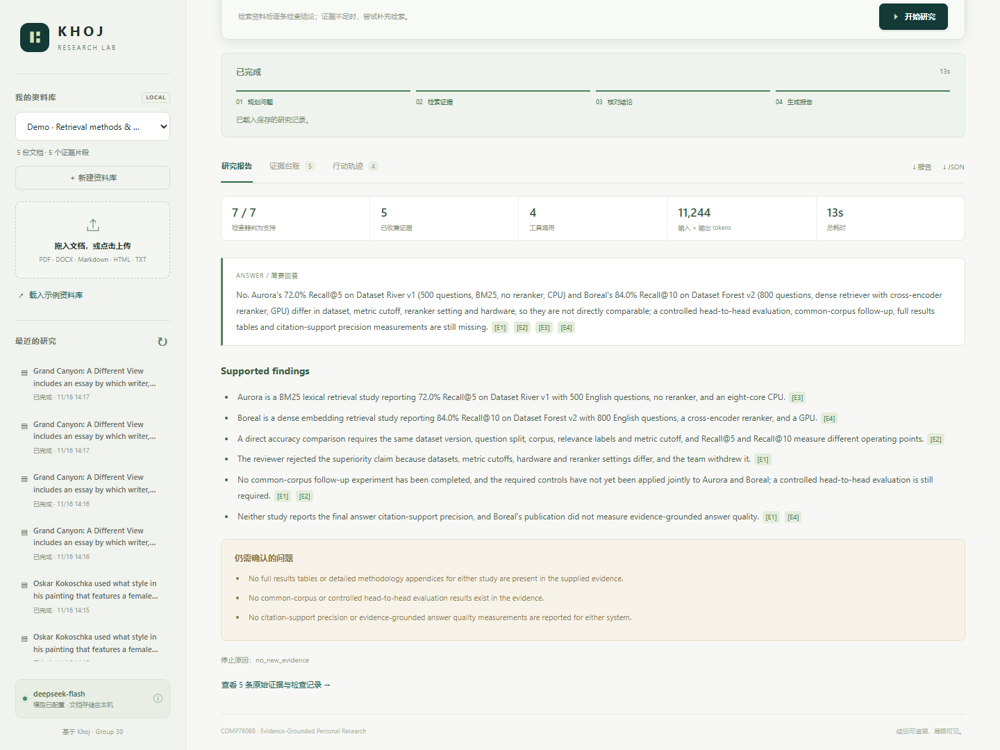

# Khoj Research Lab：项目实现与本地部署报告

COMP7608B Large Language Models · Group 30

交付日期：2026 年 11 月 16 日

## 1. 项目内容与交付边界

项目依据《Evidence-Grounded Personal Research with a Tool-Using AI Agent》proposal 实现。目标用户是需要综合论文、笔记和技术文档的学生与研究人员。用户导入自己的资料后，可以提出包含多个子问题的研究请求；系统规划检索、选择工具、生成候选结论，检查结论是否被引用原文支持，并在信息不足时补充检索或明确拒答。

主要交付是一套实际可启动的本地 Web 应用、完整课程实现源码、固定版本 Khoj 上游源码、数据准备和评测代码、实验数据清单、自动化测试、运行记录以及本报告。这里的“本地部署”指应用、文本存储与嵌入检索在本机运行；默认 DeepSeek 模型推理通过网络 API 完成。另提供独立的本地开源生成模型备用方案。

当前 proposal 的组员为：

| 姓名 |
|---|
| Xu Kaizhi |
| Wang Yudong |
| Tang Ziming |
| Liu Jitong |

本报告区分软件实现、实际运行验证和科学实验结论。测试通过或验证器输出 supported，不代表已经完成双人盲评，也不代表 proposal 中的可靠性提升目标已经得到证实。

## 2. 开源基座与改动

基座为 https://github.com/khoj-ai/khoj ，固定提交 ae229ca894c0b80ad84664afcfdde523b5e87057。上游遵循 AGPL-3.0-or-later。上游原始 checkout 位于 upstream/khoj，课程适配模块位于 app/khoj_core.py；来源文件、抽取范围和哈希见 docs/UPSTREAM.md 与 docs/upstream-manifest.json。

实际复用的内容包括 Khoj 的 Markdown 标题分节逻辑、研究规划提示词、四种工具定义、ToolCall 与 ResearchIteration 协议、成功工具调用去重逻辑，以及工具观察历史的组织方式。这些模块在实际文档导入和研究控制器中执行，另有自动化测试覆盖。

完整 Khoj 产品还依赖 Django、PostgreSQL/pgvector 及较大的多媒体和模型依赖。本机没有 Docker，课程任务也不需要全部产品功能。因此采用保留相关上游核心、重做轻量服务与验证层的适配路线：FastAPI 提供 API，SQLite 存储文档、向量和运行记录，NumPy 完成小规模语料的向量检索，原生 HTML/CSS/JavaScript 提供研究界面。

这不是“完整 Khoj 服务已部署”的声明。若课程要求运行未经裁剪的 Khoj 产品，需要另外部署上游数据库和服务栈，并把本项目的证据门禁接到其路由；当前交付满足的是 proposal 中的个人研究 Agent 功能。

## 3. 系统结构

工作流：文档导入 → 原文分块与索引 → 研究规划 → 工具检索 → 候选结论 → 独立检查 → 补检索或停止 → 引用报告。

| 层次 | 实现 | 主要责任 |
|---|---|---|
| Web 界面 | 原生 HTML/CSS/JavaScript | 资料库、上传、模式选择、进度、证据弹窗、日志和导出 |
| 服务层 | FastAPI + Uvicorn | 本地 API、任务队列、取消、输入校验、运行恢复 |
| Khoj 适配核心 | app/khoj_core.py | 上游规划提示词、工具协议、Markdown 分节、调用去重 |
| 检索层 | FastEmbed / ONNX、BGE-small-en-v1.5、BM25、RRF | CPU 嵌入、词法和语义召回、融合排序 |
| 证据与状态 | SQLite、稳定来源 ID、哈希 | 原文、来源位置、候选结论、运行结果与引用追溯 |
| 控制与检查 | Python 状态控制、Pydantic、独立模型调用 | 决策预算、结构化输出、数值/引用检查、语义检查与修复 |
| 评测 | Python 脚本、官方 HotpotQA scorer、CSV 盲评表 | 固定数据、五配置对照、自动指标、人工指标与置信区间 |

默认生成模型为用户已有账户中的 deepseek-flash，服务地址为 https://api.deepseek.com，温度为 0，显式禁用其 thinking 模式，以免思考 token 消耗结构化输出预算。规划、草稿和检查共享同一个基础模型，但检查使用独立结构化调用和专门提示词。这里的“独立检查”不意味着检查器与生成器的错误统计独立。

## 4. 核心实现细节

### 4.1 文档与证据定位

支持 TXT、Markdown、文本 PDF、DOCX 和 HTML。Markdown 经过 Khoj 标题解析，再切成有界的原文片段；PDF 保存页码和页内提取文本的字符范围；HotpotQA 保留原始标题及句子编号。引用只使用原始文本片段，不把人工拼接的检索标题当作原文。

各资料库分开检索。上传同名文件会更新对应文档及索引；文本、句子或页结构发生改变时，来源摘要和 chunk 标识随之改变。重复导入完全相同的文档可复用已存在索引。解析后的文本与索引在 SQLite 中持久化，原始上传文件不另存副本。

文本 PDF 的“字符范围”指提取后的页面文本，不是 PDF 文件字节偏移。扫描文件不做 OCR；空白或无法提取文字的 PDF 会明确报错。

### 4.2 检索与工具

语义检索使用固定的 BGE-small-en-v1.5，经 FastEmbed 的 ONNX Runtime 在 CPU 上运行。向量归一化并存储在 SQLite，查询时以 NumPy 计算余弦相似度。BM25 同时检索词法信息，通过 RRF 融合两个排序，默认每次返回六段。当前为小规模语料的全量向量扫描，没有引入额外向量数据库或近似索引。

四类工具沿用 Khoj 名称：semantic_search_files、view_file、search_web、read_webpage。view_file 只能访问已导入资料库中的来源 ID 或标题，不能任意读取本机文件。搜索结果摘要只供规划选择 URL；必须读取实际网页后，才能将内容纳入可引用证据。

网页读取保留文本快照、URL、检索时间和内容哈希。读取前检查公共 HTTP(S) 地址，重定向后再次校验；私有地址和回环地址不允许被网页工具访问。这是本地课程应用的基本限制，不是完整的公网爬虫安全方案；当前没有实现 DNS 解析结果与实际连接 IP 的强绑定。

### 4.3 有界研究流程

用户请求先分解为子问题和所需证据。规划器每轮可选择至多两个工具动作，观察结果后决定继续、换查询或停止。成功的相同工具-参数组合被跳过，瞬时网络或工具超时最多重试一次，重试也计入工具预算。初始多步检索最多四轮，余下决策预算可用于验证触发的修复。

默认上限为六轮决策、十二次实际工具尝试、两轮修复和十六次实际模型请求。云端运行默认时间预算 240 秒；备用小模型为 900 秒。API 请求有有界超时，取消与总预算在操作前后检查。取消不是强行撤销已经发往模型服务的请求；在途请求可能先结束，其迟到输出不作为成功结果接受。

### 4.4 证据台账与检查门禁

候选结论保存 ID、文本、关联证据 ID、状态、理由与原文引句。检查先验证证据 ID 存在，再检查结论中的数字是否出现在引用段落中；随后用独立的模型调用判断完整语义支持，输出 supported、contradicted 或 insufficient。

检查器必须返回确切原文引句和对应证据 ID；不存在的 ID、非逐字引文、缺失的结论判定不能直接成为“已支持”。涉及比较时，提示词要求检查数据集、指标、单位、日期与实验设置。数值相同本身不会被当作语义成立的充分证据。

短答案另建 A0 结论，要求最终答案文字确实出现在被检查的完整陈述中。完整模式只有在 A0 通过检查后才输出该答案。其他未通过的候选结论留在台账和未解决事项中，不作为报告的已支持发现。缺少答案，即使没有生成任何候选结论，也能触发补检索。

修复会针对失败结论或未解决问题重新规划检索，只有得到新证据才重新生成并检查；无新证据或预算耗尽则停止。系统没有微调、强化学习、多 Agent 投票或无限自我反思流程。

### 4.5 日志与费用

每次工具尝试记录参数、状态、用时、证据 ID 和失败信息。每次模型请求记录阶段、实际模型标识、输入/输出 token、失败情况与完成原因。失败响应只要返回 usage，也会计入；没有返回 usage 的请求标记为未知，不能算作零消耗。

只有同时配置输入价、输出价与定价日期时，才生成美元费用估算。当前默认保留实际 token 用量，费用字段为 null，避免编造价格。运行结果可导出 JSON 和 Markdown，API 密钥不会出现在导出中。

## 5. 数据与实验实现

固定抽样种子为 20261116。已准备 FRAMES 的 20 道开发题与 100 道测试题，以及 HotpotQA 的 20 道训练来源开发题和 40 道公开 development 来源测试题，共 180 道。

FRAMES 的共享冻结语料含 395 篇文档：375 篇来源并集加 20 篇固定干扰文档。HotpotQA 使用 60 个十段上下文集合，共 600 段、2,499 个原始句子。权威清单只引用这些规范集合；下载中断后留下的未引用缓存不属于实验输入。

参考答案、支持事实标签及正确来源对应关系保存在 data/evaluation，运行语料在 data/corpus。评测器以正向白名单选择导入字段，不把 gold 信息传入 Agent。完整性检查确认 180 道题、61 个集合、995 篇规范文档的哈希与支持句位置一致。

五种配置为：无工具 LLM、单次 RAG、多步无验证 Agent、完整验证/修复 Agent，以及保留验证但禁用修复的消融。各检索配置共享模型、语料、嵌入、检索参数与答案长度设置。固定语料实验关闭实时网页访问，实际验证调用纳入用量。

自动指标包含标准化 answer EM/F1、HotpotQA 官方 supporting-fact F1、回答率、失败数、延迟中位数/P95、工具与模型调用次数、token 用量和任务级配对 bootstrap 区间。支持事实预测只取最终显示结论实际引用的句子，不把全部检索结果算作支持事实。

人工评估工具可以导出隐藏系统名称与检查器标签的两份独立盲评表，并在标注完成后计算一致率、Cohen's kappa、引用支持精度、覆盖、任务成功、正确拒答和扰动恢复率。未填写这些标注时，相应字段为 null。空白表格或 checker 判断不会被当成完成的人类实验。

鲁棒性脚本支持一次工具超时、一次空检索、加入无关文档、移除官方支持句。干净与扰动结果分别汇总。删除官方支持句不保证剩余材料一定不可回答，因此证据不足条件仍需两位审阅者确认。

FRAMES 的 Wikipedia 快照来自发布者标注为 2024 年 10 月的公开集合，未必符合每道问题更早的时点。120 道逐题时点/答案版本审阅尚需人工完成；脚本默认不将未审阅任务作为正式 FRAMES 评测。诊断模式会明确记录这一限制。

## 6. 完成度与验证结果

### 6.1 按交付项核对

| 交付项 | 当前状态 | 验证依据 |
|---|---|---|
| Khoj 核心复用与来源记录 | 已实现 | 固定上游源码、抽取脚本、源文件哈希与许可证 |
| 文档导入、语义检索与资料库隔离 | 已实现并测试 | 本机实际导入、原文位置检查、自动化测试 |
| 规划、四类工具与有界控制 | 已实现并运行 | 真实模型 trace、实时网页工具测试、预算审计 |
| 证据台账、独立检查与补检索 | 已实现并运行 | 真实演示和开发集扰动记录 |
| 本地界面、历史、取消与导出 | 已部署并验证 | 浏览器实际操作、桌面/手机截图 |
| 180 道题与规范语料准备 | 已完成 | 61 个集合、995 篇文档、完整性清单 |
| HotpotQA 40 题 × 5 配置 | 已执行一次完整矩阵 | 200 个留出任务记录及官方自动评分 |
| 三次重复实验 | 未完成 | 本次每配置每题仅运行一次 |
| 预选八题的完整扰动对照 | 未执行 | 本次只做一道开发题的四种机制诊断 |
| FRAMES 100 题正式测试 | 未执行 | 120 道开发/测试题仍需时点/答案版本人工审阅 |
| 双人引用与任务盲评 | 工具已实现，标注未完成 | 盲评表、协调与汇总脚本；人工指标为空 |
| 本地生成模型备用方案 | 已安装并做引擎测试 | 真实 JSON 接口测试；未将其混入 DeepSeek 对照 |

### 6.2 软件与端到端验证

自动化测试实际通过 88 项。覆盖来源隔离、PDF 页码及文本范围、来源更新、引用与数字检查、精确引句、短答案门禁、补检索、消融配置、重复调用、重试、预算、取消、失败用量、地址限制和评测数据隔离。模型响应的单元测试采用可控模拟，因此测试数量不等同于真实模型正确率。

真实演示任务在 13.282 秒完成，调用模型 4 次、工具 4 次，输入 9,117、输出 2,127 tokens。它判断 Aurora 与 Boreal 的原始分数不可直接比较，报告可点击查看五段保存原文。检查器将 A0 与六条候选结论标为 supported；这仅是自动检查结果，不是 100% 人工引用精度。

实际浏览器验证包括导入、已保存任务深链接、引用弹窗、台账、轨迹、JSON 导出和手机布局。另一次允许联网的完整研究任务在 19.094 秒完成，实际执行 search_web 和 read_webpage，基于原始论文页面回答 RAG 2020 论文及两类记忆的问题；五次模型调用产生 16,963 个输入和 2,096 个输出 tokens。该演示独立保存在 docs/validation/live-web-run.json，不计入固定语料实验。它证明当时实时流程可用，不代表长期网页可靠性。备用 Qwen2.5-1.5B 在本机 Vulkan GPU 上通过一次 JSON 引擎探测，未进行完整课程评测。

### 6.3 冻结后的留出集结果

以下为官方公开 development split 中预先选定的 40 道 HotpotQA 留出题，不是官方隐藏测试榜单。五配置各运行一次，共 200 个任务。应用源码哈希、模型、嵌入和预算在运行前冻结；实验期间未调提示词，未执行网页工具。失败任务保留在分母中。指标按 0-100% 展示。表中的端到端延迟包含提交、排队、轮询与 HTTP 开销，不含预先下载和建库；服务端纯执行时间另保存在结果文件中。

| 配置 | Answer EM | Answer F1 | 支持事实 F1 | 失败任务 |
|---|---|---|---|---|
| 无工具 LLM | 35.0% | 47.8% | 0.0% | 0/40 |
| 单次 RAG | 60.0% | 76.1% | 69.6% | 0/40 |
| 多步无验证 | 65.0% | 84.0% | 72.8% | 0/40 |
| 完整 Agent | 52.5% | 67.5% | 70.3% | 0/40 |
| 验证但不修复 | 55.0% | 66.9% | 68.9% | 0/40 |

支持事实 F1 衡量最终引用到的原始句子与官方支持句标签的重叠，不等同于人工语义引用支持精度。

| 配置 | 端到端中位秒数 | P95（秒） | 每题 token 中位数 | 拒答任务 |
|---|---|---|---|---|
| 无工具 LLM | 2.11 | 4.03 | 582 | 0/40 |
| 单次 RAG | 2.12 | 3.14 | 2,012 | 1/40 |
| 多步无验证 | 7.22 | 9.36 | 9,926 | 1/40 |
| 完整 Agent | 10.30 | 15.54 | 13,170 | 4/40 |
| 验证但不修复 | 9.80 | 13.56 | 12,934 | 10/40 |

本次留出矩阵累计 625 次模型请求，1,477,463 个输入 tokens、118,532 个输出 tokens。这些数值包含各任务的检查和已记录失败尝试；开发调试与引擎探测单独记录，不混入该矩阵。未配置带日期的计费单价，故美元费用保持为空。

完整 Agent 相对多步无验证的 Answer EM 差值为 -12.5 个百分点，支持事实 F1 差值为 -2.6 个百分点，每题 token 中位数之比为 1.33。这些结果需同时结合回答率、拒答与人工检查解释；不把更保守或更少回答自动视为更好。

本次结果是负面发现：完整验证流程没有带来自动答案指标的提升。EM 差值的任务级配对 bootstrap 95% 区间为 [-25.00, -2.44] 个百分点。检查器误判、格式约束和额外拒答可能影响覆盖与答案表现，需要逐题人工审阅才能区分原因；不能以其更复杂或更昂贵来宣称更可靠。

任务级配对 bootstrap 95% 区间保存在 summary.json 的 paired_comparisons 中。40 道公开题、单次运行且无双人语义评分，无法单独证明 proposal 的主假设；应报告负面结果和不确定性。

### 6.4 开发集与扰动诊断

最终开发小样本为两题五配置，共十次运行，另有四个扰动运行。开发实验中，完整 Agent 的 Answer EM 为 50%，与多步无验证相同；两者服务端执行时间中位数分别为 10.586 秒和 5.797 秒。该小样本用于发现协议问题，不应作为泛化成绩。

同一道开发题的 timeout、empty 和 irrelevant 场景均完成并返回正确短答案；移除支持句的场景返回空答案，保留未解决事项。四种场景分别耗时 10.782、10.718、8.688 和 10.297 秒。它们验证了重试、补检索和拒答机制，但只有一道题，也没有两位审阅者核验剩余证据，不能宣称普遍恢复率或正确拒答率为 100%。

### 6.5 已观察到的失败与局限

开发题中出现“style”与金标准“oil on canvas”的口径歧义：无验证回答将同一艺术家的其他作品信息推为被问画作的风格，完整模式拒绝了未被相关段落支持的推断。自动 EM 给拒答零分；这应作为需要人工语义协调的案例，而不是直接宣布拒答一定正确。

留出集逐题配对中，二十题两种多步模式都满足 EM，六题只有无验证模式满足，一题只有完整模式满足，十三题均不满足。一个修复成功的例子通过歌曲作者 Future、真实姓名 Wilburn 与出生地段落之间的连接找到了 Atlanta, Georgia；一个明显需要复核的错误把键盘手 Luis Resto 与合作的说唱歌手 Eminem 的角色混淆，却仍被检查器标为支持。这些事后案例保存在 paired-outcomes-and-cases.json，没有据此修改模型或分数。

另有题目把 Canberra 喷气轰炸机与二战西南太平洋战区联系起来，但引用材料写的是该飞机在二十世纪五十年代制造，某部队在二战作战，之后才装备 Canberra。完整模式因时间关系未得到支持而拒答，原始 EM 仍为零。这提示部分金标准或题目关系可能存在噪声；当前未重评分，需双人复核，不能把全部 EM 降幅直接等同于事实可靠性下降。

演示 A0 的自动检查理由承认“缺少完整结果表”这一部分未被直接证明，却仍以核心比较结论成立为由标为 supported。这是检查器可能放过部分未支持内容的实际案例。精确引文存在检查没有解决全部语义蕴含问题，不能把界面绿色标签直接计作人工金标准。

开发阶段还发现云端账户余额不足，以及默认 thinking 消耗输出预算导致结构化内容为空的问题。余额恢复后已重试；最终冻结配置显式禁用官方 DeepSeek API 的 thinking，所有配置使用相同短答案格式和 token 上限。早期调试记录保留在独立目录，不混入最终留出结果。

### 6.6 尚未完成的实验工作

尚未完成三次重复、预选八题的完整扰动对照、FRAMES 时点/版本人工审阅及正式测试、双人引用盲评与证据不足条件核验。相应人工指标和主假设结论保持未定。软件、数据和复现脚本已经交付，可以继续这部分课程研究，但不应把它写成已经取得的实验成果。

## 7. 本地部署

项目根目录为 D:\RA\khoj-personal-research。当前环境为 Windows、Python 3.10.22、Intel Core i7-14650HX、约 16 GB 内存。默认检索不需要 GPU；本地生成备用模式可使用本机 NVIDIA GPU 的 Vulkan 后端，也有 CPU 后备。

启动默认 DeepSeek 模式：

```powershell
Set-Location D:\RA\khoj-personal-research
.\scripts\start.ps1 -OpenBrowser
```

浏览器地址：http://127.0.0.1:8778 。应用只监听本机回环地址，不向局域网或公网开放。停止命令为 scripts/stop.ps1，脚本会校验 PID 属于本项目 Python 与 Uvicorn 后才停止。数据库和历史记录保留。

另一台 Windows 电脑需要 Python 3.10-3.12，解压代码后执行 scripts/setup.ps1，并传入兼容 Python 的完整路径。依赖锁定在 requirements-lock.txt。首次需要联网下载依赖和嵌入模型；之后本地向量无需反复下载。

密钥由项目根目录 .env 加载，该文件不进入代码压缩包。复制 .env.example 后配置 LLM_BASE_URL、LLM_MODEL 和 LLM_API_KEY。费用估算可另设 INPUT_USD_PER_MILLION、OUTPUT_USD_PER_MILLION 与 PRICING_DATE。不要将密钥放入数据、测试、截图或公开仓库。

独立本地生成模型的安装、启动和切换：

```powershell
.\.venv\Scripts\python.exe scripts/setup_local_model.py
.\scripts\start_local_model.ps1
.\scripts\stop.ps1
.\scripts\start.ps1 -LocalModel -OpenBrowser
```

该模式覆盖启动进程中的模型环境变量，不修改原 DeepSeek 配置。模型与 llama.cpp 版本、许可证和下载哈希记录在 docs/local-model-manifest.json。目前只验证了备用推理引擎的启动、结构化 JSON 调用和停止，未验证该小模型完成整个研究 Agent 流程；CPU 后端仅完成下载和完整性校验。小模型与 DeepSeek 的能力不同，不能将其结果混入同一模型的受控对照实验。详细记录见 docs/LOCAL_MODEL.md。

## 8. 使用方法

首次演示可点击“载入示例资料库”。五份文件说明 Aurora 与 Boreal 两种虚构检索方法及其不同实验设置。它们明确标为合成教学材料，用于检查系统是否能发现数据集和指标不可直接比较，不是论文成绩。

示例问题：Compare Aurora and Boreal. Are their reported scores directly comparable, and what evidence is still missing?

选择“完整 Agent：证据检查 + 修复”，默认关闭联网。提交后可看到阶段进度；完成后点击 [E1] 等引用查看原文、位置和来源。证据台账保留被支持、反驳或缺少证据的候选结论。行动轨迹显示工具参数、失败与尝试次数。

自己的资料可通过左侧创建资料库后上传。每批最多二十个文件，每个不超过 10 MB。系统保存解析文本，不自动扫描本机其他目录。使用云端模型时，选中的证据文本会发往云端推理；“关闭联网检索”只禁止网页工具，不代表云端模型也断网。

Markdown 导出适合展示报告，JSON 导出包含检查状态、证据、调用、用量及配置，适合复核与实验。历史任务可在重启后重新打开。没有完成的任务不显示为成功；重启时遗留的 running/queued 状态会标记为失败。

以下截图来自实际已完成的 DeepSeek 运行，不是填充的示例结果。界面中的支持标签来自自动检查器，仍需要人工复核。



图 1：研究报告和逐条引用。完整原始截图保存在 docs/screenshots。


图 2：点击引用后查看保存的原文、来源 ID 与位置。

## 9. 复现命令与交付目录

```powershell
.\.venv\Scripts\python.exe scripts/doctor.py
.\.venv\Scripts\python.exe -m pytest -q
.\.venv\Scripts\python.exe -m eval.check_data
.\.venv\Scripts\python.exe -m eval.run --dataset hotpotqa --split dev --limit 2 --output eval/results/my-pilot
```

同一冻结配置、同一输出目录可以续跑；更换模型、数据、预算或场景应使用新目录。默认开发试验每题五个配置、各一次。完整 140 道测试题、五配置、三次重复最多构成 2,100 个任务，每个任务又有多次模型调用；这套命令已提供，但不得误写成所有任务已经运行。

| 路径 | 内容 |
|---|---|
| app/ | API、Khoj 适配核心、检索、模型客户端、证据 Agent 和界面 |
| scripts/ | 安装、启动、停止、环境诊断、上游与本地模型准备 |
| tests/ | 不依赖付费 API 的自动化回归测试 |
| data/demo/ | 五份教学演示材料 |
| data/corpus/、data/evaluation/、data/manifests/ | 冻结语料、独立 gold、来源与完整性清单 |
| eval/ | 数据准备、五模式运行器、官方评分适配、盲评与扰动 |
| eval/results/ | 实际运行与指标，按实验配置隔离 |
| docs/ | 本报告、上游说明、数据说明和验证证据 |
| runtime/ | 本机数据库、日志和 PID；不进入可分享代码包 |
| models/、.venv/ | 本机下载模型与依赖；可由脚本重建 |
| upstream/khoj/ | 固定版本完整开源基座 |

## 10. 限制与后续工作

证据检查器可能误判，尤其是隐含条件、跨段推断和复杂数值比较；精确引文校验只能保证引文存在，不能保证逻辑结论一定成立。单模型同时生成和检查也可能产生相关错误。

当前嵌入面向英语，两个基准均为英语；中文界面不等于中文检索已验证。检索为小语料全量扫描，大资料库需增加近似索引。扫描 PDF、图片表格、OCR 和复杂表格理解不在本版范围。

公开网页可能变化、限流或无法读取。固定语料实验减少了这些变动，但不能代表全部实时网页故障。模型也可能在训练时见过公开基准；小样本试运行不能证明普遍可靠性。

API 返回的是模型名称，服务未提供本项目可以锁定的权重版本；已记录实际返回名称、运行日期及参数，但服务端升级仍可能影响复现。温度为 0 也不保证每次输出完全相同。

进一步工作应先完成双人引用盲评与 FRAMES 时点审阅，再在冻结配置下运行全测试集及重复试验，报告正面与负面结果。proposal 中“支持精度提升至少 10 个百分点、可回答任务成功下降不超过 5 个百分点、token 中位数不足两倍”是待检验假设，不能由功能完成或程序测试直接推出。

## 11. 参考与许可

- Khoj 源码：https://github.com/khoj-ai/khoj ，上游许可与固定提交见 docs/UPSTREAM.md。
- ReAct：https://arxiv.org/abs/2210.03629 。本项目采用交替决策与工具观察的有界模式。
- FRAMES：https://huggingface.co/datasets/google/frames-benchmark 。固定数据版本、快照许可和时间限制见 docs/DATASET.md。
- HotpotQA：https://hotpotqa.github.io/ 。本次使用公开训练/开发子集，不是官方隐藏测试集结果。
- ALCE：https://aclanthology.org/2023.emnlp-main.398/ 。答案正确性与引用质量分开评价。
- 数据、模型和评分脚本各自保留来源与许可，不能把它们全部重新标成项目自有 AGPL 内容。
